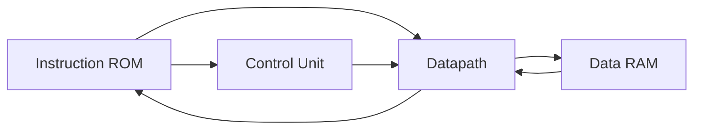

# RV32I Single-Cycle CPU 구성

## 모듈 구성

- `top_rv32i_soc`: Instruction ROM, CPU, Data RAM 연결
- `control_unit`: opcode/funct 해석과 제어 신호 생성
- `rv32i_datapath`: Register File, ALU, 즉시값, Write-back 및 PC 경로
- `instruction_mem`: 상대경로 `instruction_code.mem`을 읽는 명령어 ROM
- `data_mem`: 로드·스토어 데이터 경로
- `tb_rv32i`: 클럭·리셋을 구동하는 기존 테스트벤치

## 검증 범위

프로젝트 설명은 명령어별 기능 확인과 1~10 합산 프로그램의 a0=55 확인 경험을 다룹니다. 원본 테스트벤치는 초기화 후 20개의 negedge를 기다리고 `$stop`하므로, 전체 프로그램 실행에 충분한지는 선택한 메모리 내용과 실행 사이클에 따라 별도로 확인해야 합니다. 자동 PASS를 출력하는 테스트로 소개하지 않습니다.

`TEST_SIMULATION` 조건부 ROM 초기화와 `$readmemh`가 함께 존재하므로 기본 스크립트에서는 해당 define을 추가하지 않습니다. 32,768개 테스트나 RV32I 전체 규격 준수는 제공 소스로 새로 입증하지 않았습니다.

## 디버깅 경험

분기 제어의 X 전파, J-Type 즉시값 비트 재조합, 메모리 읽기 신호의 중복 구동을 검토했습니다. X를 단순히 0으로 덮는 변경을 일반적인 해결책으로 제시하지 않습니다.
